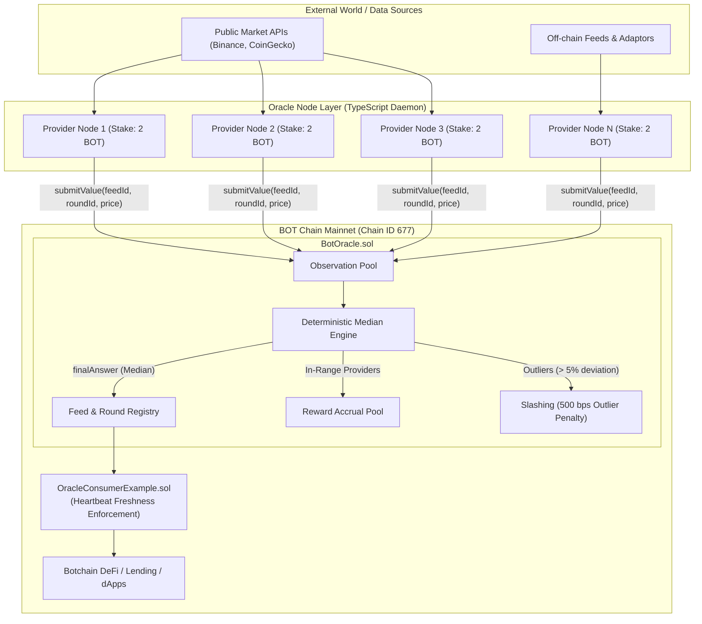

# BotOracle: Decentralized Oracle Protocol on Botchain

> *"Trusted data for decentralized applications."*

BotOracle is an end-to-end, production-quality decentralized oracle network built for the **BOT Chain Mainnet (Chain ID: 677)**. The protocol establishes verifiable on-chain truth through independent provider reporting, fixed-point deterministic median aggregation, economic collateral staking in native BOT, and automated deviation-based slashing.

---

## Architecture Overview



---

## Protocol Design & Security Principles

### Important Oracle Security Model
BotOracle **does not claim** that smart contracts can independently verify real-world external truth. Real-world accuracy emerges from:
1. **Provider Diversity**: Decentralized set of independent nodes reporting observation data.
2. **Deterministic Median Aggregation**: Rather than vulnerable arithmetic means, the protocol computes the exact mathematical median of all valid submissions per round. Byzantine outliers cannot distort the final answer.
3. **Economic Collateral & Staking**: Providers stake native BOT as collateral.
4. **Transparent Outlier Slashing**: Submissions deviating beyond the feed's configured basis points threshold (e.g., 500 bps = 5%) are classified as outliers and slashed, with penalties credited to the protocol reward pool.
5. **Freshness & Heartbeat Protection**: Every consumer contract and frontend view enforces maximum age thresholds (`block.timestamp - latestUpdatedAt <= heartbeat`). Stale data is rejected on-chain.

---

## Mathematical Specification

### 1. Scaled Integer Decimals
To eliminate floating-point imprecision in Solidity:
$$\text{ScaledValue} = \text{RawValue} \times 10^{\text{decimals}}$$
*Example (BTC/USD, 8 decimals)*:
$$\$112,470.50 \longrightarrow 11247050000000$$

### 2. Deterministic Median Calculation
Given $N$ submissions sorted in non-decreasing order:
$$S = [v_1, v_2, \dots, v_N]$$
- **Odd $N$**:
  $$\text{Median} = v_{\lfloor N/2 \rfloor}$$
- **Even $N$**:
  $$\text{Median} = \left\lfloor \frac{v_{N/2 - 1} + v_{N/2}}{2} \right\rfloor$$

### 3. Outlier Detection Formula (Basis Points)
For each submitted value $v_i$ and finalized median $M$:
$$\Delta = |v_i - M|$$
$$\text{DeviationBps} = \frac{\Delta \times 10,000}{|M|}$$
If $\text{DeviationBps} > \text{ThresholdBps}$ (e.g. 500 bps = 5%):
- Provider is flagged as an **Outlier**.
- Provider is slashed by configured percentage:
  $$\text{Penalty} = \min\left(\text{Stake}, \frac{\text{Stake} \times \text{SlashBps}}{10,000}\right)$$
- If remaining stake falls below `minStake`, the provider is automatically deactivated.

---

## Directory Structure

```
Work 12/
├── contracts/
│   ├── BotOracle.sol                 # Core protocol contract
│   ├── interfaces/
│   │   └── IBotOracle.sol            # Lightweight consumer interface
│   └── examples/
│       └── OracleConsumerExample.sol # Heartbeat enforcement consumer contract
├── test/
│   ├── BotOracle.test.ts             # 23 automated protocol tests
│   └── OracleConsumer.test.ts        # 3 consumer integration tests
├── scripts/
│   ├── deploy.ts                     # Botchain deployment script
│   └── seed.ts                       # Demonstration seed script
├── oracle-node/                      # Standalone provider node daemon
│   ├── src/
│   │   ├── index.ts                  # Daemon polling and submission loop
│   │   ├── client.ts                 # Viem client configuration
│   │   ├── abi.ts                    # Typed ABI definition
│   │   └── sources/
│   │       ├── DataSource.ts         # Extensible adapter interface
│   │       ├── CoinPriceSource.ts    # Public market API adapter
│   │       └── MockSource.ts         # Deterministic mock adapter
│   └── package.json
├── frontend/                         # Next.js 14 App Router Web3 UI
│   ├── app/
│   │   ├── page.tsx                  # Protocol landing page with live on-chain stats
│   │   ├── feeds/                    # Active data feeds directory
│   │   ├── feed/[id]/                # Feed detail, provider breakdown, outliers
│   │   ├── providers/                # Provider marketplace
│   │   ├── provider/[address]/       # Provider profile & factual telemetry
│   │   ├── provider/register/        # Node onboarding & staking
│   │   ├── dashboard/provider/       # Operator portal (stake, claim, pause)
│   │   ├── round/[feedId]/[roundId]/ # Round verification & deviation table
│   │   ├── admin/                    # Role-gated admin console
│   │   └── developer/                # IBotOracle snippets & SDK docs
│   ├── lib/
│   │   ├── chain.ts                  # BOT Chain Mainnet definition (Chain ID 677)
│   │   ├── contracts/botoracle.ts    # Contract address & typed ABI
│   │   └── identity.ts               # BotNS-ready identity resolver
│   └── package.json
├── sdk/                              # Standalone Developer SDK
│   └── index.ts
├── hardhat.config.ts
├── package.json
└── .env.example
```

---

## Network Configuration

| Parameter | Value |
|---|---|
| **Network Name** | BOT Chain Mainnet |
| **Chain ID** | `677` |
| **RPC Endpoint** | `https://rpc.botchain.ai` |
| **Explorer** | `https://scan.botchain.ai` |
| **Native Token** | `BOT` (18 decimals) |
| **BotOracle Contract** | [`0x5175b608d7c0e10a4eD0D605d5cA59b1f2E88BBa`](https://scan.botchain.ai/address/0x5175b608d7c0e10a4eD0D605d5cA59b1f2E88BBa) |

---

## Local Setup & Quickstart

### 1. Prerequisites
- Node.js 18+ / 20+
- npm or yarn

### 2. Install Root Dependencies & Compile
```bash
npm install
npm run compile
```

### 3. Run Automated Tests
```bash
npm test
```
*Executes all 26 unit and integration tests covering provider registration, staking lifecycles, round management, median calculation, outlier penalties, pull-payment reward claims, and consumer freshness checks.*

### 4. Deploy Locally / Run Seed Demo
```bash
npx hardhat node
# In another terminal:
npm run seed:local
```

### 5. Run the Oracle Node Daemon
```bash
cd oracle-node
cp .env.example .env
# Configure ORACLE_PRIVATE_KEY and BOTORACLE_CONTRACT_ADDRESS in .env
npm run start
```

### 6. Run the Next.js Web3 Frontend
```bash
cd frontend
npm run dev
```
Open [http://localhost:3000](http://localhost:3000) in your browser.

---

## Deploying to BOT Chain Mainnet

1. Copy `.env.example` to `.env`:
```env
DEPLOYER_PRIVATE_KEY=0xyour_private_key_here
BOTCHAIN_RPC_URL=https://rpc.botchain.ai
```
2. Execute deployment:
```bash
npm run deploy:mainnet
```
The script will output the deployed contract addresses and save metadata to `deployments/botchain.json`.

---

## Smart Contract Integration Example

Consuming verified oracle feeds from any Botchain smart contract:

```solidity
// SPDX-License-Identifier: MIT
pragma solidity ^0.8.24;

import "./interfaces/IBotOracle.sol";

contract LendingProtocol {
    IBotOracle public immutable oracle;
    uint256 public constant MAX_AGE = 3600; // 1 hour staleness check

    error StalePriceException(uint256 updatedAt, uint256 maxAge);

    constructor(address _oracle) {
        oracle = IBotOracle(_oracle);
    }

    function getCollateralPrice(uint256 feedId) external view returns (int256 price) {
        (int256 answer, uint256 updatedAt, ) = oracle.getLatestAnswer(feedId);

        if (block.timestamp - updatedAt > MAX_AGE) {
            revert StalePriceException(updatedAt, MAX_AGE);
        }

        return answer;
    }
}
```

---

## Future Protocol Roadmap

### V2: Multi-Source Ingestion & Automation
- Pluggable multi-exchange weighted averaging per provider node
- Permissionless round initialization triggered by price change thresholds
- Automated heartbeat health monitoring

### V3: Cryptographic Proofs & Keepers
- Decentralized keeper network for automated round finalization
- Cryptographic TLS-notary / zkTLS external data-source authenticity proofs
- Cross-chain data delivery

### V4: Decentralized Identity & Governance
- BotNS name resolution (`provider.bot`)
- BotRepute provider credentialing and reputation tracking
- Full DAO-governed parameter updates (slashing rates, heartbeat, rewards)

### V5: Omnichain Oracle Delivery
- Cross-chain state synchronization to EVM layer-1 and layer-2 rollups
- High-frequency sub-second orderbook telemetry
