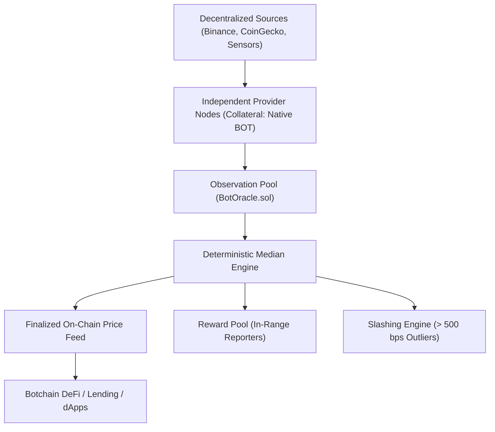

# BotOracle: Decentralized Oracle Protocol on Botchain
## Technical Whitepaper & Project Pitch

**Protocol**: BotOracle  
**Target Network**: BOT Chain Mainnet (Chain ID: 677)  
**Contract Address**: `0x5175b608d7c0e10a4eD0D605d5cA59b1f2E88BBa`  
**Repository**: [github.com/liljhnxn/botoracle](https://github.com/liljhnxn/botoracle)  
**Explorer**: [BotScan Address](https://scan.botchain.ai/address/0x5175b608d7c0e10a4eD0D605d5cA59b1f2E88BBa)  

---

## 1. Executive Summary

Smart contracts on Botchain are deterministic and self-contained; they cannot independently verify external real-world truth, such as asset prices, off-chain computations, or market event outcomes. Centralized oracle alternatives introduce single points of failure, censorship risks, and vulnerability to price manipulation.

**BotOracle** is an end-to-end decentralized oracle network purpose-built for Botchain. By combining **independent multi-node provider reporting**, **deterministic mathematical median aggregation**, **economic collateral staking (native BOT)**, and **automated deviation slashing**, BotOracle delivers high-integrity, tamper-resistant data feeds directly to Botchain dApps, DeFi protocols, and smart contracts.

---

## 2. Problem Statement

1. **The Oracle Problem**: DeFi lending, algorithmic trading, and prediction markets require reliable price feeds. A single corrupted feed can cause cascading liquidations and protocol insolvency.
2. **Vulnerability of Arithmetic Means**: Simple averages are vulnerable to single-node manipulation: a single extreme outlier can disproportionately warp the aggregate price.
3. **Sybil & Free-Rider Exploits**: Without mandatory economic collateral, malicious nodes can spam false reports at zero cost.
4. **Data Staleness & Frontrunning**: Without explicit heartbeat and timestamp validation on-chain, contracts are vulnerable to stale price arbitrage during periods of market volatility.

---

## 3. The BotOracle Solution

BotOracle establishes verifiable consensus through four interlocking pillars:

1. **Provider Diversity & Staking**: Node operators must stake native `BOT` (minimum 1 `BOT`) as collateral. Malicious or inaccurate behavior carries immediate financial loss.
2. **Deterministic Mathematical Median**: Submissions are sorted on-chain, and the exact median is calculated. Even if up to $\lfloor (N-1)/2 \rfloor$ nodes report corrupt values, the median remains protected.
3. **Automated Deviation Slashing & Reward Distribution**:
   - Providers reporting within the allowable deviation threshold receive protocol rewards.
   - Outliers deviating beyond the threshold (e.g., 500 bps = 5%) are slashed on-chain (5% stake penalty), with slashed funds reinforcing the reward pool.
4. **Heartbeat & Staleness Enforcement**: All consumer contracts enforce `block.timestamp - latestUpdatedAt <= heartbeat`, ensuring stale data is rejected before execution.

---

## 4. Mathematical & Protocol Specification

### 4.1 Scaled Integer Representation
To prevent floating-point loss in EVM execution:
$$\text{ScaledValue} = \text{RawValue} \times 10^{\text{decimals}}$$

### 4.2 Deterministic Median
For $N$ sorted submissions $[v_1, v_2, \dots, v_N]$:
- **Odd $N$**: $\text{Median} = v_{\lfloor N/2 \rfloor}$
- **Even $N$**: $\text{Median} = \lfloor (v_{N/2 - 1} + v_{N/2}) / 2 \rfloor$

### 4.3 Outlier Detection & Penalty
For submission $v_i$ and median $M$:
$$\text{DeviationBps} = \frac{|v_i - M| \times 10,000}{|M|}$$
If $\text{DeviationBps} > \text{ThresholdBps}$ (e.g., 500 bps):
$$\text{Penalty} = \min\left(\text{Stake}, \frac{\text{Stake} \times \text{SlashBps}}{10,000}\right)$$

---

## 5. Ecosystem & Technical Stack

| Layer | Implementation | Details |
|---|---|---|
| **Smart Contracts** | Solidity 0.8.24, OpenZeppelin | `BotOracle.sol`, `IBotOracle.sol`, `OracleConsumerExample.sol` |
| **Node Daemon** | TypeScript, Node.js, Viem | Automated polling, multi-source ingestion (Binance, CoinGecko, custom), automated round submission |
| **Web3 Application** | Next.js 14, Wagmi, TailwindCSS | Feed directory, live round inspection, provider registry, operator dashboard, developer docs |
| **Developer SDK** | TypeScript SDK | Zero-friction 1-line integration helper for dApp developers |
| **Test Suite** | Hardhat, Mocha/Chai | 26 passing automated unit and integration tests |

---

## 6. Tokenomics & Incentive Alignment

- **Collateral Sink**: Every registered oracle node locks native BOT, taking supply out of circulation.
- **Sustainable Reward Vault**: Rounds pay a fixed reward (`0.01 BOT`) to accurate reporters. Slashed funds from faulty nodes are redirected back to the reward pool.
- **Timelocked Unbonding**: 1-hour delay prevents hit-and-run attacks during disputed rounds.

---

## 7. Roadmap

- **Phase 1 (Complete)**: Core protocol deployment, automated median aggregation, staking, deviation slashing, and Web3 explorer on BOT Chain Mainnet.
- **Phase 2**: Multi-source aggregator daemon with automated heartbeat keeper triggers.
- **Phase 3**: Cryptographic zkTLS / TLS-notary external source authenticity proofs.
- **Phase 4**: BotNS (`.bot`) identity integration and BotRepute on-chain node credentialing.
- **Phase 5**: Cross-chain state synchronization to EVM L1/L2 networks.
